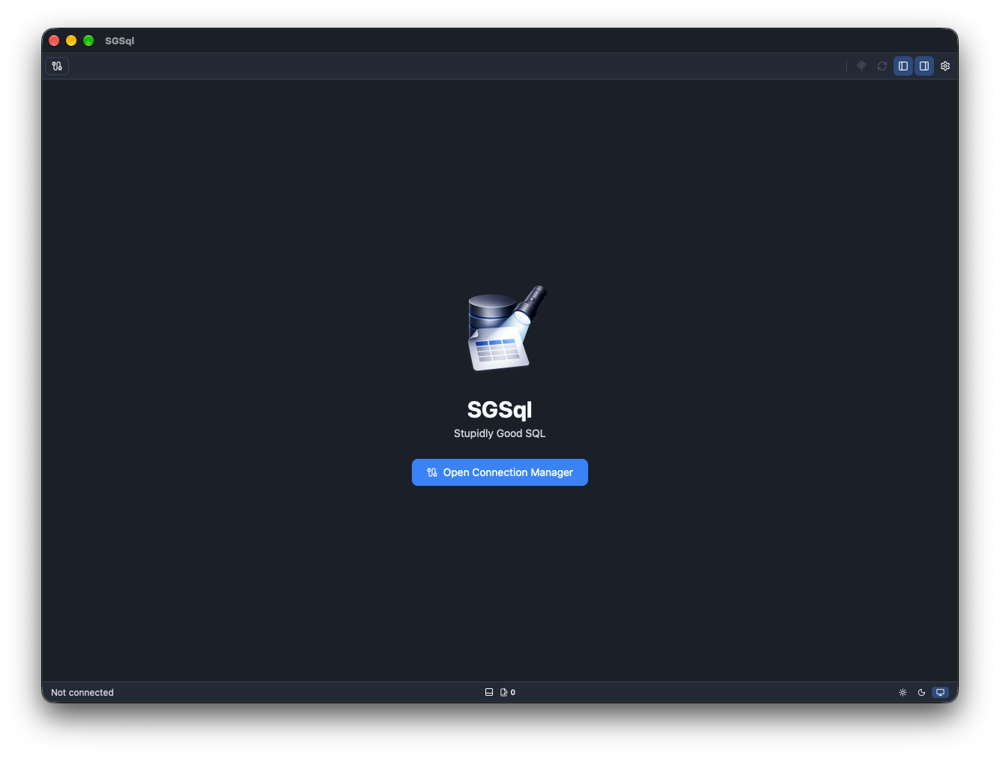
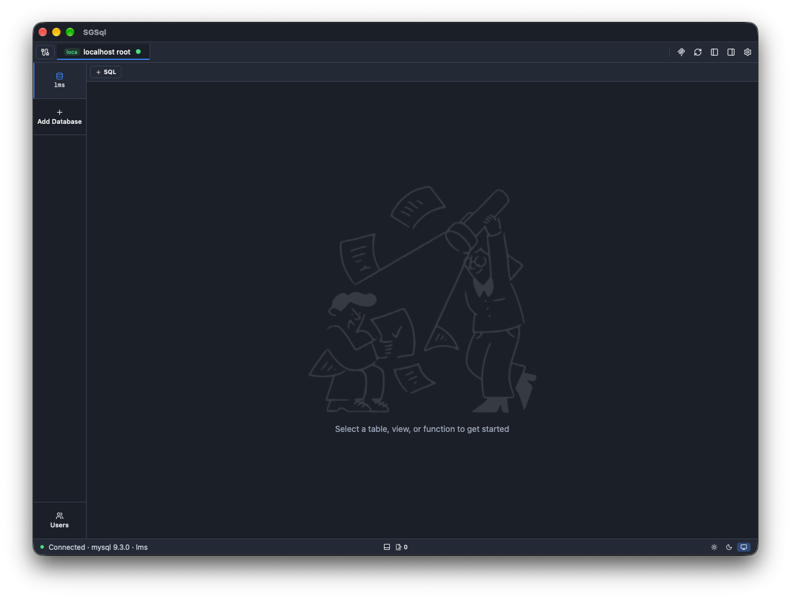
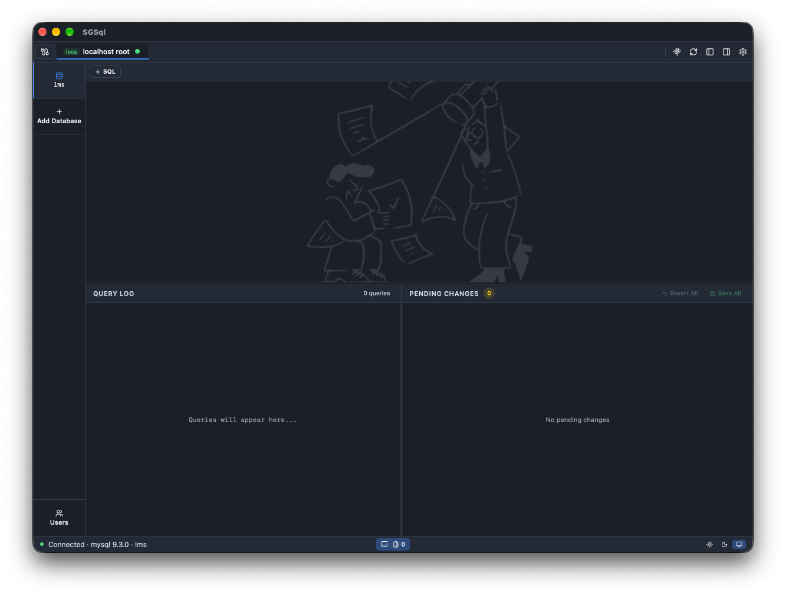
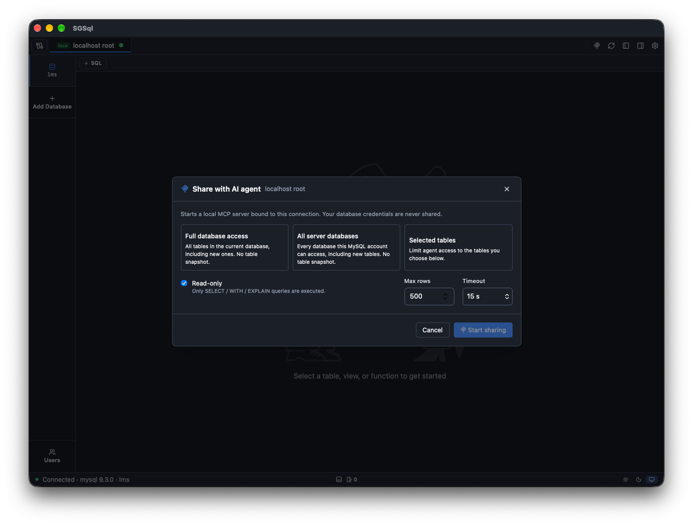
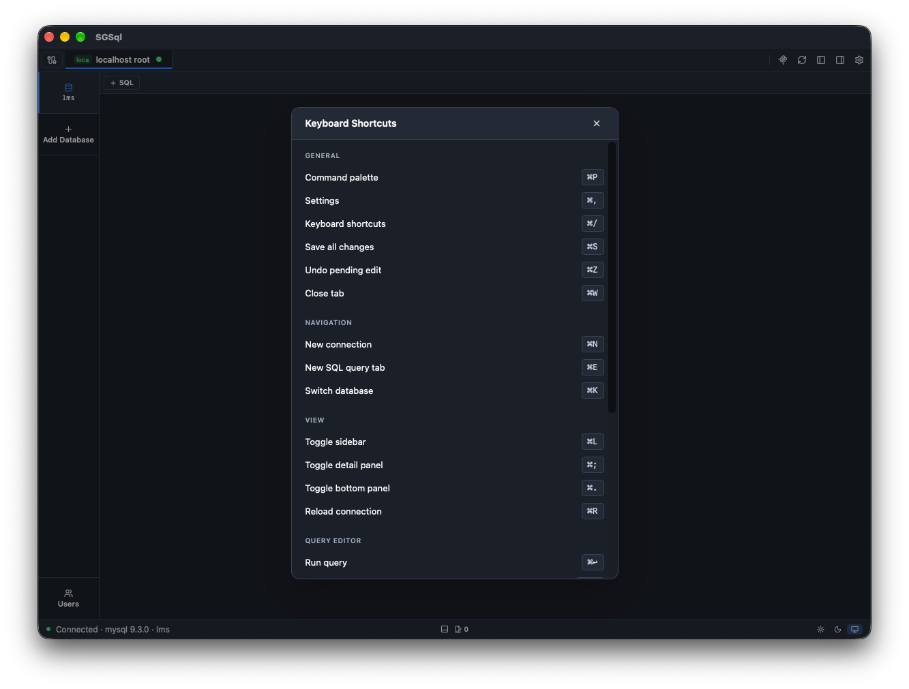

# SGSql

**Stupidly Good SQL** — a fast desktop SQL client for MySQL, PostgreSQL,
SQLite and Oracle, with a built-in way to share a connection with AI agents
over MCP.



Most SQL clients are either slow and bloated or missing the one thing you
need. SGSql opens fast, runs your query and gets out of the way.

## Features

- **MySQL, PostgreSQL, SQLite and Oracle**, including connections over SSH
  tunnels. Oracle needs no client libraries (see [Oracle notes](#oracle-notes))
- **Monaco editor** (the editor behind VS Code) with schema-aware autocomplete
- **Fast data grid** with inline row editing, filters, sorting and a
  pending-changes panel to review, save or revert edits
- **Keyboard-first**: command palette (⌘P), switch database (⌘K), new query
  tab (⌘E), fuzzy search across tables, views and functions
- **Import and export**: export several tables at once; SQL import runs in a
  single transaction
- **Query history and log**, with query output remembered per connection
- **Share with AI agents**: expose an open connection to Claude Code, Cursor,
  Codex and other agents as a local MCP server

### Share a connection with AI, safely

Instead of pasting schemas into a chat or handing an agent your real
credentials, click the MCP icon and share the connection:

- Choose the scope: selected tables, the whole database, or (MySQL) every
  database the account can reach
- **Read-only by default**; read-write is opt-in
- The agent never sees your credentials. Every statement is parsed and
  checked first, and DDL and side-effect functions like `pg_sleep` are blocked
- Row caps and per-statement timeouts
- The agent's queries appear in your query log, so you can see exactly what it ran
- Shares end when the tab closes, with a fresh token every time

Then ask things like *"why is this report query slow?"* or *"find orders with
no matching invoice"* and the agent works against the real schema. See
[Share a connection with an AI agent](#share-a-connection-with-an-ai-agent)
for the full details.

## Download

Get the latest `.dmg` from
[Releases](https://github.com/stalingino/sgsql/releases/latest). The app
updates itself after that.

- macOS on Apple Silicon only, for now
- Builds are not notarized yet, so the first launch needs a right-click →
  **Open** (or approval in System Settings → Privacy & Security)

## Screenshots

| Connected to a database | Query log and pending changes |
|---|---|
|  |  |

| Share with an AI agent | Keyboard shortcuts |
|---|---|
|  |  |

## Share a connection with an AI agent

Any open connection can be shared with an AI coding agent (Claude Code,
Cursor, Codex, …) as a local [MCP](https://modelcontextprotocol.io) server.
Click the MCP icon in the top-right toolbar, choose **Selected tables** or
**Full database access** (the current database). MySQL connections also offer
**All server databases** for every database the account can access. Choose
**Read-only** (default) or read-write, and start sharing. Neither full-database
nor all-server access enumerates tables when the share starts; both cover tables
added later.


The dialog shows a ready-to-paste config, for example:

```bash
claude mcp add --transport http sgsql-my-db https://127.0.0.1:45822/mcp/<share id> \
  --header "Authorization: Bearer <token>"
```

The endpoint is served over HTTPS by default, using a certificate from a
local SGSql CA that is created on first run and only valid for `localhost`,
`127.0.0.1` and `::1`. Agents must trust that CA: click **Trust certificate**
in the share dialog or in Settings (macOS and Windows add it to your user trust
store after a system prompt; on Linux add `mcp-ca.pem` from the app data
directory yourself). Agents on Node.js may ignore the system store; start them
with `NODE_EXTRA_CA_CERTS=<path to mcp-ca.pem>`. To use plain HTTP instead,
turn off **Serve the agent endpoint over HTTPS** in Settings.

The agent gets `list_tables` (names only, with an optional `pattern` filter),
`describe_table`, `get_table_ddl` and `query`; read-write shares also get
`transaction`, which runs up to 100 statements all-or-nothing, and all-server
MySQL shares also get `list_databases`. Writes return `affectedRows` plus
`lastInsertId` (MySQL/SQLite) or `RETURNING` rows (Postgres/SQLite), and
`query` accepts `maxValueLength` to cut long text values short. On MySQL,
`SHOW COLUMNS`, `SHOW CREATE TABLE` and `DESCRIBE` work for accessible tables. It never sees your database
credentials: the sidecar executes statements on its own dedicated connection
and enforces the rules before anything reaches the database.

- Every statement is parsed; only selected tables, tables in the current
  database (full access), or databases accessible to the MySQL account
  (all-server access) may be referenced, one statement per call. Other MySQL
  databases use qualified names such as `analytics.events`.
  DDL / `SET` / `COPY` / transaction control and
  side-effect functions (`pg_sleep`, `pg_terminate_backend`, `sleep`, …) are
  rejected. Read-only shares also run in a database-level read-only session.
- Results are capped (500 rows by default) and each statement has a timeout
  (15 s by default); both limits are stated in the tool descriptions.
  The 500-table limit applies only to selected-table shares; full database
  and all-server shares have no table-count limit. `list_databases` discovers
  database names and `list_tables` discovers tables in one database on demand.
- Shares are session-only: they stop when the tab is closed or SGSql quits,
  and a new token is generated every time.
- Agent statements show up in the query console like your own.
- The MCP listener binds `127.0.0.1:45822` (falls back to a free port if it is
  taken) and refuses browser origins; each share has its own bearer token.

Known limitations: a shared *view* may read tables that are not shared, and
SQL the parser does not understand is rejected rather than executed.

## Oracle notes

Oracle connections use the pure-Rust [`oracledb`](https://github.com/oracle/rust-oracledb)
driver, so no Oracle Client or Instant Client install is needed.

- **Versions**: Oracle 12c or later (table paging uses `OFFSET … FETCH`).
- **Connecting**: enter the service name (e.g. `ORCLPDB1`), or a full
  `(DESCRIPTION=…)` connect descriptor for SIDs and failover lists. "Use SSL"
  connects over TCPS.
- **Session formats**: each session sets `NLS_DATE_FORMAT` and
  `NLS_TIMESTAMP_FORMAT` to ISO (`YYYY-MM-DD HH24:MI:SS`) so edited dates
  convert back. Queries that rely on the database's default date format for
  implicit conversions should use `DATE '…'` or `TO_DATE` instead.
- **Scripts**: end PL/SQL blocks, procedures, packages and triggers with a
  `/` line, as in SQL*Plus. SQL Developer exports import as-is.
- **Transactions**: every statement commits on its own unless you run a
  batch with Atomic on. DDL commits implicitly, as it always does in Oracle.
- **Privileges**: cancelling a running query and the process list need the
  `ALTER SYSTEM` privilege and `SELECT_CATALOG_ROLE`; user management needs
  `SELECT_CATALOG_ROLE` (or DBA). Cancelling ends the session and SGSql
  reconnects automatically.
- **Foreign-key checks** can't be switched off per session in Oracle, so the
  toggle is hidden for Oracle connections.

## License

Free for personal and other non-commercial use under the
[PolyForm Noncommercial License 1.0.0](LICENSE).

Oracle support includes the [`oracledb`](https://github.com/oracle/rust-oracledb)
crate, Copyright (c) 2026, Oracle and/or its affiliates, used under the
[Universal Permissive License (UPL) 1.0](https://oss.oracle.com/licenses/upl).
